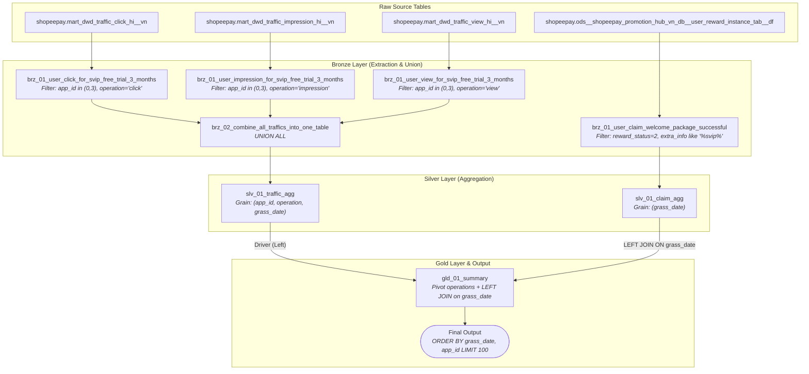

# Tracking Traffic `SVIP` that include in `Welcome Package`

> script: [tracking welcome package - svip](scripts/welcome_package_for_svip_tracking/tmp_traffic_svip_with_welcome_package.sql)

## Objective:

Find all the users who have claimed the SVIP free trial package.
    - Number of clicks 
    - Number of views
    - Number of impressions
   
**Note:** all above metrics must follow the `SVIP free-trial welcome-package`.

## Asset:

**data traffic click**:

* type: `data-warehouse-detail`

* schema: `shopeepay`

* name: `dwd_traffic_click_hi__vn`

**data traffic impression**:

* type: `data-warehouse-detail`

* schema: `shopeepay`

* name: `dwd_traffic_impression_hi__vn`

**data traffic view**:

* type: `data-warehouse-detail`

* schema: `shopeepay`

* name: `dwd_traffic_view_hi__vn`

**welcome package**:

* type: `operational-data-store`

* schema: `shopeepay`

* name: `ods__shopeepay_promotion_hub_vn_db__user_reward_instance_tab__df`

## Data-Lineage:

